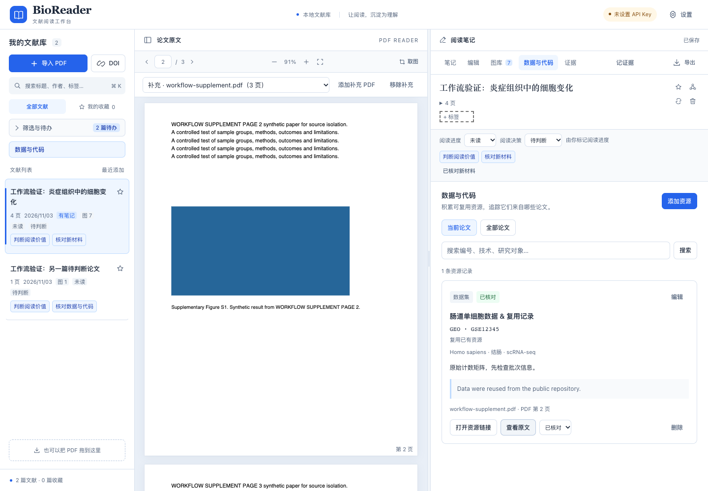

# biomedical-paper-reader

[中文](#中文) · [English](#english)

## 中文

**单篇生物医学论文精读：看懂实验为什么做，判断证据支持到哪里，提炼可以借鉴的研究设计。**

版本：v0.12.0。图库新增读图笔记查看器：点击图片或「查看笔记」，左侧查看原图，右侧以 Markdown 排版完整显示已保存的读图结果。已有结果直接可看，无需重新读图或重新生成笔记；查看器与论文正文笔记独立，不自动调用模型或改写内容。沿用中英界面、补充图图注修复及 Go + MyGo 桌面外壳。

这里的版本指当前分支源码；[正式 Releases](https://github.com/Gaoyuan-0423/biomedical-paper-reader/releases) 需单独发布，可能晚于 `main`。安装当前源码可按下文克隆或更新；维护者发布步骤见[发布维护](RELEASING.md)。

[Skill 入口](SKILL.md) · [示例报告](examples/README.md) · [验收记录](evals/RESULTS.md) · [MIT 许可](LICENSE)

### 报告长什么样

> **一句话发现：** 在 18 名供者的横断面组织比较中，病例的 Marker A 平均分数较高，但供者层面差值的置信区间包含 0；把细胞当作独立观察得到的强显著性不能证明 A 驱动疾病。
> **阅读建议：选择性阅读。** 适合精看其统计单位与结论之间的关系……
> **本文看点：** 同一数据使用不同统计单位得到不同显著性；组间年龄差异提供了需要检验的替代解释；观察结果与 Discussion 的因果措辞不匹配。

——摘自[观察研究示例](examples/observational/report.md)。三份完整示例（二手片段、观察研究、预测方法）见[示例目录](examples/README.md)。

### 输入与模式

提供 PDF、DOI、论文链接或原文即可开始，无需先写研究问题。二手解析或部分材料也能处理，但会明确覆盖范围与暂定判断；仅有短片段时合并无实质内容的章节，篇幅来自原文信息量。

| 模式 | 实际读取与交付 |
|---|---|
| 完整精读（默认） | 通读可用正文和方法，逐张概览已有主图／补图，必要面板深入核查；交付论证与逐图／结果解释，未完成范围标受限 |
| 速读 | 先读摘要、问题、结果结构与讨论，再定点核查筛选判断依据的图、对照及方法；列明未读范围，不声称全文核验 |
| 指定图／方法 | 解析目标并补足影响解释的上下文、必要对照和已有相关补图；交付局部设计、结果、边界及适配建议 |

完整精读的报告结构：开篇导读 → 文章信息 → 研究概述 → 全文逻辑路线图 → 逐图／逐结果精读 → 研究总结与课题借鉴 → 数据与方法资源。有文件工具时交付独立论文目录下的 `report.md`（图像放 `assets/`，相对路径）；没有文件工具时直接输出文本。详见[报告模板](references/report-template.md)与[模式与语言适配](references/reading-modes.md)。

### 核心规则

- **阅读报告与过程记录分开。** 正文围绕作者的问题、设计、结果和论证；页码清单、查看事件、覆盖表、证据索引独立保存，用户要求核查或审稿时再展示。见[证据规则](references/evidence-rules.md)。
- **补充材料默认只用本地已有文件**，用户明确要求补取才联网下载；附件缺失不当作作者未做验证。
- **实际查看图像后才描述视觉信息。** 转换、复制或插入报告不算查看；逐图状态由[逐图记录](references/reading-record.md)和[标准库校验器](scripts/check_reading_record.py)约束。
- **措辞与推断强度相称。** 观察不写成因果、救援不等于必要性、联合不自动成协同、模型效果不自动成为患者疗效；统计单位与样本层级逐项区分。
- **范围内每个结果单元都要解释**研究问题、方法输入输出与论证衔接，不能只给前几图方法、后续退化为图片或疑点清单。
- **语言由用户要求决定**，英文论文不自动触发英文输出；双语两种表述共用证据记录，数字与判断强度一致。

### 使用

#### macOS / Windows 桌面版（预览）

下载入口：[v0.12.0 桌面预览版](https://github.com/Gaoyuan-0423/biomedical-paper-reader/releases/tag/v0.12.0)。本版按 **Pre-release** 发布，稳定版及 Latest 仍为 **v0.3.4**。按系统选择同版附件，以发布页实际提供为准：

| 系统 | 下载与打开 |
|---|---|
| Apple 芯片 Mac（arm64） | [BioReader-v0.12.0-macos-arm64.dmg](https://github.com/Gaoyuan-0423/biomedical-paper-reader/releases/download/v0.12.0/BioReader-v0.12.0-macos-arm64.dmg)，打开 DMG 后将 `BioReader.app` 拖入应用程序 |
| Windows 10 / 11（x64） | [安装 EXE](https://github.com/Gaoyuan-0423/biomedical-paper-reader/releases/download/v0.12.0/BioReader-v0.12.0-windows-x64-setup.exe)，或 [BioReader-v0.12.0-windows-x64.zip](https://github.com/Gaoyuan-0423/biomedical-paper-reader/releases/download/v0.12.0/BioReader-v0.12.0-windows-x64.zip)，完整解压文件夹后打开其中的 `BioReader.exe`，保留全部随附文件 |

桌面包不需要另装 Python 或手动启动浏览器／终端。Windows 需要 Microsoft Edge WebView2 Runtime；缺少时安装[微软官方 Evergreen Runtime](https://developer.microsoft.com/en-us/microsoft-edge/webview2/)。用户数据独立保存：macOS 为 `~/Library/Application Support/BioReader/`，Windows 为 `%LOCALAPPDATA%\BioReader`；退出旧版再替换程序，已有论文、笔记和设置保留。

两平台使用同一版本、同一检查过的源码提交发布；更新时下载对应平台的新包。本版没有应用内自动更新或跨电脑文献库同步。安装、自行构建与平台限制见[桌面版说明](app/DESKTOP.md)，实际回归和打包结果见 [App 验证记录](app/tests/README.md)。macOS 包未做 Apple 开发者签名和公证。AI 模型、DOI 和相关文献查询仍需联网。



蓝白工作台 v0.5.0 实测截图（1440px，当前版已简化阅读状态并更新资源表格）：左侧筛选与待办，中间正文／补充材料阅读，右侧资源记录与原文定位。截图使用原创合成 PDF 和虚构记录。

#### 查看已有读图笔记

在「图库」点击缩略图或「查看笔记」，即可并排看图和该图已保存的完整读图观察。左侧支持适应窗口、放大和缩小，右侧支持 Markdown 标题、列表、表格与代码，并可展开原图注；窄窗口改为上下排列。没有读图结果时显示提示，可回图库主动使用原有「读图」功能。

查看无需重新提取、重新读图或重新生成论文笔记，也不会修改正文笔记。右侧不执行 HTML、不加载 Markdown 内嵌图片，也不将模型写出的内部伪引用作为跳转入口；普通安全 HTTP／HTTPS 外链可打开。左侧图片来自当前文献的本地图资源。详见 [App 读图查看器说明](app/README.md#v0120查看已有读图笔记)。

#### 更新已有补充图图注

已有补充图若仍只有标题或短图注，先在左侧 PDF 文件下拉框选择对应补充材料，再打开「图库」点击「重新提取」。无需重新导入 PDF 或重新生成笔记。更新应用本身不会自动扫描旧文献，也不会覆盖人工编辑过的图注；v0.11.1 的图注修复保持既有图片身份与裁剪区域。跨页续接只在版面可确认时进行，无法确定的内容仍需对照原文。

#### 界面语言

顶部或设置中的「界面语言」可选择「简体中文」或「English」，立即更新导航、设置、问答、资源与证据表单、搜索、Zotero 及操作提示。语言保存在本机，重启或桌面服务更换端口后继续使用；保存失败会显示重试提示。切换时保留尚未保存的笔记和表单、输入焦点、选区及生成任务，不自动翻译论文、标签、图注、已有笔记或模型回答。

#### 原文引用与阅读导航

新生成的精读笔记可显示“原文 · 页码”按钮，点击后核验来源文件版本并定位原文，有可靠坐标时高亮。引用只来自本次提供给模型的真实原文片段；旧笔记不自动猜测出处。导出会保留文件名、PDF 页码与原文摘录。

原文下方的“阅读导航”默认收起，可切换章节、图表和笔记目录。章节使用 PDF 自带书签，图表按当前正文／补充文件分别显示；点击图表同时定位原图与笔记中对应图片，笔记标题也可直接跳转。没有书签时不会生成猜测页码。

#### 对照阅读与问答摘录

顶部可切换「专注原文」「笔记对照」「边读边问」。宽窗口支持原文与笔记／问答并排，专注模式收起其他面板；窄窗口保持单面板切换。正文和补充 PDF 继续使用连续滚动、缩放和阅读位置记忆。

问答支持标题、列表、表格和代码块，引用仍需校验来源后定位。快捷问题围绕当前页或选区，填入后可修改并手动发送；它们使用有限的相关原文片段，不等同于全文精读。已完成的回答可复制，或连同文件名、PDF 页码和原文摘录追加到现有笔记；原笔记保留，重复点击同一回答不会重复追加。详情见 [App 问答说明](app/README.md#原文选字与问答)。

#### 搜索正文与整理样品

点击侧栏「搜索正文与笔记」，在本机文献库中查找关键词或原文短语。结果显示命中片段与 PDF 页码；打开 PDF 结果前校验来源版本，有坐标时高亮原文，无坐标时跳到页面。笔记结果打开对应论文的已保存笔记，不承诺精确定位笔记内的句子。搜索不调用模型，旧 PDF 首次提取本地文本缓存可能较慢；扫描件不做 OCR。

「数据与复现」保留论文原来的资源分组，分别记录物种、组织、疾病、技术、平台、实验分组与论文实际样本量。明确填写的字段可从精读表格整理，也可直接编辑；GEO 收录总量保持独立。按物种／组织／疾病／技术／平台组合筛选后，可导出当前结果的 CSV 或去重编号清单。详情见 [App 使用说明](app/README.md#数据与复现)。

#### 从 Zotero 导入

在设置中保存 Zotero MCP 地址（默认 `http://127.0.0.1:8000/mcp`）和本机 Zotero `storage` 目录，再从「Zotero」入口检索、预览并选择导入方式。首批兼容 [54yyyu/zotero-mcp](https://github.com/54yyyu/zotero-mcp) 的 Streamable HTTP 工具；可仅导入元数据，或复制已下载到本机的 Zotero 存储 PDF。已有文献按来源和 DOI 查重，命中时返回原记录并保留已有笔记，可点击「打开文献」查看。

还没安装服务时可以先保存设置。BioReader 不代装或启动 Zotero MCP，不自动导入整库，也不写回 Zotero。官方安装／启动命令、附件范围及连接排错见 [App 使用说明](app/README.md#连接-zotero-mcp)。

#### 直接使用

```bash
git clone https://github.com/Gaoyuan-0423/biomedical-paper-reader.git
```

```text
请使用 ./biomedical-paper-reader/SKILL.md 阅读这份 PDF，生成中文精读报告。
```

路径相对于你的工作目录；必要时改用 `SKILL.md` 的绝对路径。要使用客户端的技能发现功能，将整个目录放入它支持的 skills 目录，保留 `references/`。

#### Codex 本地安装与更新

```bash
mkdir -p ~/.codex/skills
git clone https://github.com/Gaoyuan-0423/biomedical-paper-reader.git ~/.codex/skills/biomedical-paper-reader
```

已安装副本用 `git pull` 更新；`SKILL.md` 标题下标注了当前版本，可与 [CHANGELOG](CHANGELOG.md) 对照确认没有装错版本。使用自定义配置目录时改用其对应 skills 目录；已存在同名版本时先比较内容，保留自己的修改。

```text
使用 $biomedical-paper-reader 解析这篇论文：<DOI、链接或附件>。
```

语言与模式直接表达即可，例如“用英文速读这篇论文，判断是否值得精读”或 "analyze Figure 3 in English, including the methods and controls needed to interpret it"。双语或专题方法同样直接说明；这些是分析报告，不是全文逐句翻译。可补充研究方向以获得更贴合的迁移建议；未补充时给条件式适用场景。

### 工作方式

依赖宿主提供的文件、PDF 和图像工具；没有固定 MCP 服务器、第三方 skill 或付费服务要求。

按所选模式建立并复用原文章节、图表和主张索引，再联读相关正文、Methods、图注及图像。核心结论、引用数字和主要批评都有独立可追溯记录；正文以科学含义解释结果。多队列／嵌套样本记录个体→组织→切片→细胞层级及分析单位；机制链逐边说明证据与缺口；方法检查点按研究设计选用，不要求每篇出现固定技术链条。无图论文按主表、结果小节或方法单元展开。未实际执行的代码和数据不会被标为已经复现。长论文按[增量笔记流程](references/material-handling.md)逐图落盘、组装成稿。

### 文件组织

- `SKILL.md`：触发说明、工作流和交付要求。
- `references/`：[报告模板](references/report-template.md)、[模式与语言](references/reading-modes.md)、[证据规则](references/evidence-rules.md)、[研究检查点](references/study-checks.md)、[材料处理](references/material-handling.md)、[逐图记录](references/reading-record.md)。
- `scripts/check_reading_record.py`：逐图记录与声明一致性的标准库校验器。
- `scripts/render_pdf_page.py`：可选 PDF 页渲染辅助（需 pypdfium2 或 PyMuPDF，非运行依赖）。
- `app/`：[BioReader App](app/README.md)——按本 skill 方法论实现的本地文献阅读应用（FastAPI + 原生 JS；PDF 双栏解析与图注锚定取图、精读/速读流式笔记、读图模型、DOI 导入与相关文献、Markdown/Word/公众号一键复制导出），与 skill 本体相互独立，`./app/run.sh` 即用。
- `agents/openai.yaml`：可选的 Codex 界面元数据。
- `evals/cases.md`、`evals/fixtures/`：行为验收设计和原创虚构材料。
- `evals/PROTOCOL.md`：用自备论文复现行为评测的协议。
- `evals/RESULTS.md`：版本对应的验收入口；历史记录与新回归分开。
- `evals/test_reading_record.py`、`evals/validate_repo.py`：执行回归与仓库完整性检查（CI 自动运行）。
- `examples/`、`evals/runs/`：示例与各版本实际试读输出、评分及失败记录。
- `CHANGELOG.md`：版本变化。

### 示范与验证

两篇真实试读材料用于检验不同研究路径，技能指令不依赖其中的具体基因、疾病或方法顺序：

- [HCC 新辅助 nivolumab 多模态研究](https://doi.org/10.1186/s12943-026-02682-x)
- [小鼠结肠炎突变与空间邻域研究](https://doi.org/10.1038/s41588-026-02673-0)

各版实际输出、语义评分、失败和未运行项见 [验收记录](evals/RESULTS.md)：v0.1.0 两篇真实论文与三份虚构短文；v0.2.0 语言／模式及附件更新；v0.3.0 逐图动作校验与全补图回归；v0.3.1 后续方法解释；v0.3.2 报告与过程记录分离。v0.3.3 为工程与结构修订（入口重写、规则去重、CI、示例重排）；v0.3.4 为 Action、运行镜像和自动更新配置维护，两版均未重跑行为试读。局部试读不扩称为真实论文或视觉全流程重跑；完整第三方论文、原图和原始数据不随公开仓库分发。

开发验证：`python3 evals/validate_repo.py` 检查本地链接与记录完整性，`python3 evals/test_reading_record.py` 运行记录回归；两者由 GitHub Actions 在每次推送时自动执行。要用自己的论文做行为评测，按 [PROTOCOL.md](evals/PROTOCOL.md) 进行。视觉夹具可用已有 Pillow 运行 `python3 evals/generate_visual_fixtures.py` 重建；Pillow 仅用于开发夹具，技能阅读不强制 Python 或任何库。

### 来源与许可

本 skill 根据实际阅读需求独立编写，借鉴 `nature-reader` 的原文定位/图文联读思想，以及 `paper-deep-note` 的来源覆盖声明思想。未复制其实现文件或全文翻译工作流，也不依赖这些技能。参考时无法确认所见本地版本的原仓库或许可，因此这里仅注明思想来源，不重分发其内容。

本仓库的原创技能指令、模板、说明及虚构示例采用 [MIT License](LICENSE)。文中链接的第三方论文、数据和工具由各自权利人持有，适用其自身许可；本仓库许可证不延伸至这些外部材料。

### 反馈与贡献

欢迎通过 [Issues](https://github.com/Gaoyuan-0423/biomedical-paper-reader/issues) 提交适配问题或通过 Pull Request 改进。反馈最好包括论文 DOI/公开链接、出现问题的输出、原文定位，以及期望的处理方式；只分享有权公开的材料。规则变更应说明针对哪个证据问题，并更新相应案例或记录，避免为单篇论文写死疾病、基因或技术顺序。

---

## English

**Read one biomedical paper closely: understand why each experiment was done, assess what the evidence supports, and identify research designs you can adapt.**

Version: v0.12.0. The figure gallery now opens a figure-note viewer: click a thumbnail or View notes to see the image alongside the complete saved figure observation, rendered as Markdown. Existing results are immediately available without another model reading or note generation. Viewing stays separate from paper-level notes and does not call a model or rewrite content. Bilingual UI, supplementary-caption fixes and the Go + MyGo desktop shell remain available.

This version describes the source on the current branch. [Formal Releases](https://github.com/Gaoyuan-0423/biomedical-paper-reader/releases) are published separately and may lag behind `main`. Clone or update as described below to use the current source; maintainers can follow the [release guide](RELEASING.md).

[Skill entry point](SKILL.md) · [Example reports](examples/README.md) · [Evaluation records](evals/RESULTS.md) · [MIT License](LICENSE)

### What a report looks like

> **Finding in one sentence:** In a cross-sectional tissue comparison involving 18 donors, cases had a higher mean Marker A score, but the confidence interval for the donor-level difference included 0; the strong statistical significance obtained by treating cells as independent observations does not establish that A drives disease.
> **Reading recommendation: Read selectively.** Focus on the relationship between the unit of analysis and the conclusions…
> **Points of interest:** The same data yield different levels of statistical significance when analyzed using different units; age differences between groups offer an alternative explanation that needs to be tested; the observations do not support the causal wording in the Discussion.

—Translated from the [observational-study example](examples/observational/report.md). See the [example directory](examples/README.md) for three complete reports based on fictional materials: a secondary-source excerpt, an observational study, and a prediction-method study.

### Inputs and reading modes

Provide a PDF, DOI, paper link, or original text to get started; you do not need to formulate a research question first. Secondary interpretations and partial materials can also be analyzed, with explicit coverage limits and provisional judgments. For short excerpts, sections with no substantive content are combined; report length reflects the information available in the source.

| Mode | What is read and delivered |
|---|---|
| Full close reading (default) | Read the available main text and methods, inspect every available main and supplementary figure, and examine selected panels in detail as needed. Deliver an explanation of the argument and each figure/result, and mark any incomplete coverage as a limitation. |
| Quick screening | Start with the abstract, research question, results structure, and discussion, then check the specific figures, controls, and methods underlying the screening recommendation. State what was not read; do not claim full-paper verification. |
| Focused figure/method analysis | Analyze the target and add the context, necessary controls, and available relevant supplementary figures needed to interpret it. Explain the local design, results, limits, and possible adaptations. |

A full close-reading report follows this structure: opening guide → article information → research overview → roadmap of the paper's argument → figure-by-figure/result-by-result analysis → study summary and ideas for future research → data and methods resources. When file tools are available, the deliverable is `report.md` in a dedicated paper directory, with images in `assets/` and relative links. Otherwise, the report is returned as text. See the [report template](references/report-template.md) and [reading modes and language adaptation](references/reading-modes.md).

### Core rules

- **Keep the reading report separate from process records.** The report explains the authors' questions, designs, results, and reasoning. Page lists, viewing events, coverage tables, and evidence indexes are stored separately and shown when the user requests verification or peer review. See the [evidence rules](references/evidence-rules.md).
- **Use only locally available supplementary materials by default.** Download missing supplements only when explicitly requested. A missing attachment is not evidence that the authors omitted a validation.
- **Describe visual information only after actually viewing the image.** Converting, copying, or inserting an image into a report does not count as viewing it. Figure-level status is governed by the [figure reading record](references/reading-record.md) and its [Python standard-library validator](scripts/check_reading_record.py).
- **Match wording to the strength of the inference.** Observation does not establish causation; rescue does not establish necessity; a combination is not automatically synergistic; performance in a model does not automatically imply efficacy in patients. Distinguish statistical units and sample hierarchies explicitly.
- **Explain every result unit within scope:** the research question, the method's inputs and outputs, and its role in the argument. Later figures must receive the same methodological attention as earlier ones, rather than becoming a list of images or concerns.
- **Follow the user's requested output language.** An English-language paper does not automatically trigger English output. Both versions of a bilingual report share the same evidence records, numbers, and strength of judgment.

### English quick start

#### macOS / Windows desktop preview

Download page: [v0.12.0 desktop preview](https://github.com/Gaoyuan-0423/biomedical-paper-reader/releases/tag/v0.12.0). This is a **Pre-release**; **v0.3.4** remains the stable Latest release. Choose the matching platform asset from the files actually published:

| Platform | Download and open |
|---|---|
| Apple silicon Mac (arm64) | [BioReader-v0.12.0-macos-arm64.dmg](https://github.com/Gaoyuan-0423/biomedical-paper-reader/releases/download/v0.12.0/BioReader-v0.12.0-macos-arm64.dmg); open the DMG and drag `BioReader.app` to Applications |
| Windows 10 / 11 (x64) | [Installer EXE](https://github.com/Gaoyuan-0423/biomedical-paper-reader/releases/download/v0.12.0/BioReader-v0.12.0-windows-x64-setup.exe), or [BioReader-v0.12.0-windows-x64.zip](https://github.com/Gaoyuan-0423/biomedical-paper-reader/releases/download/v0.12.0/BioReader-v0.12.0-windows-x64.zip); extract the entire folder and open `BioReader.exe`, retaining all bundled files |

Desktop packages do not require Python or manually starting a browser/terminal. Windows requires Microsoft Edge WebView2 Runtime; install the [official Evergreen Runtime](https://developer.microsoft.com/en-us/microsoft-edge/webview2/) if it is missing. User data remains separate: `~/Library/Application Support/BioReader/` on macOS and `%LOCALAPPDATA%\BioReader` on Windows. Quit the old version before replacing program files; existing papers, notes and settings are preserved.

Both platforms are released under the same version from the same checked source commit. Update by downloading the new package for your platform; there is no in-app updater or cross-device library sync. See the [desktop guide](app/DESKTOP.md) for installation, source builds and platform limits, and the [App validation record](app/tests/README.md) for actual regression/build results. The macOS app has no Apple Developer ID signature or notarization. AI, DOI lookup and related-paper searches still require network access.

#### View saved figure observations

In Figures, click a thumbnail or View notes to open the image beside its complete saved observation. Fit, zoom in and zoom out apply to the image; the note pane supports Markdown headings, lists, tables and code, with an expandable source caption. Narrow windows stack the panes. Figures without saved observations show an empty state; use the existing Read figure action in the gallery when you want a new model reading.

Opening the viewer requires no re-extraction, new reading or note generation, and does not modify paper-level notes. Observation Markdown does not execute HTML, load embedded images, or activate internal source/figure pseudo-links. Safe HTTP/HTTPS links remain available; the image pane uses the current paper's local figure resource.

#### Updating existing supplementary captions

If an existing supplementary figure still has only a heading or short caption, select its supplementary file in the PDF dropdown on the left, open Figures and choose Re-extract. You do not need to re-import the PDF or regenerate notes. Updating the app does not automatically rescan existing papers or overwrite manually edited captions. This fix keeps existing figure identities and crop regions. Cross-page continuation is used only when the layout supports it; uncertain content still needs checking against the source.

#### Interface language

Choose Simplified Chinese or English from the language selector in the header or Settings. Navigation, settings, chat, research forms, search, Zotero and action messages update immediately. The preference is saved on this computer and survives restarts or a changed desktop service port; a retry prompt appears if saving fails. Unsaved notes and forms, input focus, selections and active generation are preserved. Papers, tags, captions, notes and model answers keep their original language.

#### Source links and reading navigation

New close-reading notes can link to the exact original excerpts supplied to the model. Clicking verifies the PDF revision before navigating, with highlighting where reliable geometry exists. Older notes remain readable without invented source links. Exports retain file names, PDF pages and original quotations.

The collapsible reading navigator contains native PDF bookmarks, figures from the active main/supplementary file, and note headings. Figure selection locates both the PDF page and the matching note image. PDFs without bookmarks show an explicit empty state.

#### Read alongside notes and keep useful answers

Choose focused PDF, notes comparison or reading-with-chat from the top bar. Wide windows support side-by-side PDF and notes/chat; focus mode hides the other panels. Narrow windows retain single-pane switching. Main and supplementary PDFs keep continuous scrolling, zoom and saved reading positions.

Answers render headings, lists, tables and code blocks while source navigation still verifies the referenced file. Question starters use the current page or selection; edit the inserted question and send it explicitly. These answers use bounded relevant source excerpts, not a full-paper close reading. Copy a completed answer, or append it with file names, PDF pages and original quotations to existing notes. Previous notes are preserved and repeating the same append does not duplicate it. See the [App question guide](app/README.md#原文选字与问答).

#### Search saved content and organize samples

Use the sidebar's full-text search to find keywords or source phrases across local main PDFs, supplements and saved notes. Results show actual excerpts and PDF pages. PDF opening checks the file revision, highlights the source when coordinates exist and otherwise navigates to its page. Note results open the paper's saved notes without promising exact sentence positioning. Search does not call a model. Older PDFs may take longer to build a local text cache on first use; scanned documents are not OCRed.

Data resources retain their per-paper grouping while recording species, tissue, disease, assay, platform, experimental groups and actual sample counts separately. Explicitly labeled fields can be organized from close-reading tables or edited directly; GEO collection totals remain independent. Combine species/tissue/disease/assay/platform filters, then export the current results as CSV or a deduplicated accession list. See the [App guide](app/README.md#数据与复现).

#### Import from Zotero

Save a Zotero MCP endpoint in Settings (default `http://127.0.0.1:8000/mcp`) and your local Zotero `storage` directory. Open Zotero search, preview an item and explicitly choose metadata-only or a locally downloaded stored PDF. The first adapter targets [54yyyu/zotero-mcp](https://github.com/54yyyu/zotero-mcp) over Streamable HTTP. Source identity and DOI deduplication return existing records for explicit opening without overwriting their notes.

Settings can be saved before the server is installed. BioReader does not install or start the MCP server, import a whole library automatically, or write back to Zotero. See the [App setup guide](app/README.md#连接-zotero-mcp) and the [upstream installation guide](https://github.com/54yyyu/zotero-mcp/blob/main/docs/getting-started.md). Remote-only attachments and linked files are outside this first PDF import path.

#### Direct use

```bash
git clone https://github.com/Gaoyuan-0423/biomedical-paper-reader.git
```

```text
Use ./biomedical-paper-reader/SKILL.md to read this PDF and produce a full close-reading report in English.
```

The path is relative to your working directory; use the absolute path to `SKILL.md` if needed. To use your client's skill discovery feature, place the entire folder in a supported skills directory and keep `references/` intact.

#### Local installation and updates in Codex

```bash
mkdir -p ~/.codex/skills
git clone https://github.com/Gaoyuan-0423/biomedical-paper-reader.git ~/.codex/skills/biomedical-paper-reader
```

Update an installed Git checkout by running `git pull` inside that checkout. The current version is shown below the title in `SKILL.md`; compare it with the [CHANGELOG](CHANGELOG.md) to confirm the installed version. If you use a custom configuration directory, use its corresponding skills directory. If a version with the same name already exists, compare the contents first and preserve your own changes.

```text
Use $biomedical-paper-reader to analyze this paper in English: <DOI, link, or attachment>.
```

State the language and mode directly, for example, “screen this paper in English and assess whether it merits a full close reading” or “analyze Figure 3 in English, including the methods and controls needed to interpret it.” You can likewise request a Chinese–English bilingual report or a focused method analysis. These are analytical reports, not sentence-by-sentence translations of the full paper. You may add your research area for more relevant suggestions; otherwise, suggestions are framed around the conditions under which they would apply.

### How it works

The skill relies on file, PDF, and image tools provided by the host; it does not require fixed MCP servers, third-party skills, or paid services.

For the selected mode, the skill builds and reuses an index of the paper's sections, figures, tables, and claims, then reads the relevant text, Methods, legends, and images together. Core conclusions, quoted numbers, and major criticisms have separate, traceable records; the report explains the scientific meaning of the results. For multiple cohorts or nested samples, it records the individual → tissue → section → cell hierarchy and the unit of analysis. Mechanistic chains are assessed one link at a time, with the evidence and gaps stated for each. Methodological checks are selected according to the study design; no fixed sequence of techniques is required. Papers without figures are organized around the main tables, result subsections, or methodological units. Code or data analyses that were not actually run are never described as reproduced. For long papers, the [incremental note-taking workflow](references/material-handling.md) saves notes figure by figure before assembling the report.

### Repository layout

- `SKILL.md`: activation guidance, workflow, and deliverable requirements.
- `references/`: [report template](references/report-template.md), [modes and languages](references/reading-modes.md), [evidence rules](references/evidence-rules.md), [study checks](references/study-checks.md), [material handling](references/material-handling.md), and [figure reading record](references/reading-record.md).
- `scripts/check_reading_record.py`: a Python standard-library validator for consistency between figure reading records and claims about what was read.
- `scripts/render_pdf_page.py`: an optional PDF page-rendering helper; it requires pypdfium2 or PyMuPDF, neither of which is a required dependency for using the skill.
- `app/`: [BioReader App](app/README.md), a local paper-reading application based on this skill's methodology (FastAPI + vanilla JavaScript). It supports two-column PDF parsing, figure extraction anchored to captions, streaming notes for close reading and quick screening, a vision model for figure interpretation, DOI import and related papers, and one-click copying/export for Markdown, Word, and WeChat Official Accounts. The app and the skill are independent; start the app with `./app/run.sh`. Desktop previews can be built on macOS with `./app/build-macos.sh` or on Windows with `app/build-windows.ps1`; see the [desktop guide](app/DESKTOP.md) for storage, build instructions, and validation limits.
- `agents/openai.yaml`: optional Codex interface metadata.
- `evals/cases.md`, `evals/fixtures/`: behavioral evaluation cases and original fictional materials.
- `evals/PROTOCOL.md`: a protocol for reproducing behavioral evaluations with your own papers.
- `evals/RESULTS.md`: the entry point for version-specific evaluations; historical records are kept separate from new regressions.
- `evals/test_reading_record.py`, `evals/validate_repo.py`: reading-record regression tests and repository integrity checks, run automatically in CI.
- `examples/`, `evals/runs/`: examples and actual reading outputs, scores, and failure records for different versions.
- `CHANGELOG.md`: version history.

### Examples and validation

Two real papers were used to test different research approaches. The skill's instructions do not depend on their specific genes, diseases, or sequence of methods:

- [Multimodal study of neoadjuvant nivolumab in HCC](https://doi.org/10.1186/s12943-026-02682-x)
- [Study of mutations and spatial neighborhoods in mouse colitis](https://doi.org/10.1038/s41588-026-02673-0)

See the [evaluation records](evals/RESULTS.md) for actual outputs, semantic scores, failures, and unrun cases: v0.1.0 covered two real papers and three fictional short texts; v0.2.0 covered language/mode selection and updates after supplements were added; v0.3.0 covered figure-viewing action validation and regression tests for coverage of all supplementary figures; v0.3.1 covered method explanations for later results; and v0.3.2 covered separation of reports from process records. v0.3.3 revised engineering and structure (entry-point rewrite, rule deduplication, CI, and example reorganization); v0.3.4 maintains Actions, runner images, and automatic update configuration. Neither version reran behavioral reading evaluations. Partial reading trials are not presented as full reruns on real papers or of the complete visual workflow. Full third-party papers, original figures, and raw data are not distributed with this public repository.

For development validation, `python3 evals/validate_repo.py` checks local links and record integrity, and `python3 evals/test_reading_record.py` runs reading-record regression tests. GitHub Actions runs both on every push. To evaluate behavior using your own papers, follow [PROTOCOL.md](evals/PROTOCOL.md). Visual fixtures can be rebuilt with `python3 evals/generate_visual_fixtures.py` if Pillow is available. Pillow is only used for development fixtures; using the skill to read papers does not require Python or any particular library.

### Attribution and license

This skill was written independently to meet practical paper-reading needs. It draws on `nature-reader`'s ideas of locating evidence in the original paper and reading text alongside figures, and on `paper-deep-note`'s idea of declaring source coverage. It does not copy their implementation files or full-text translation workflows, and does not depend on those skills. The original repositories and licenses of the local versions consulted could not be confirmed, so only the conceptual influences are acknowledged here; their contents are not redistributed.

The repository's original skill instructions, templates, documentation, and fictional examples are licensed under the [MIT License](LICENSE). Linked third-party papers, datasets, and tools belong to their respective rights holders and are subject to their own licenses; this repository's license does not extend to those external materials.

### Feedback and contributions

Report compatibility or adaptation issues through [Issues](https://github.com/Gaoyuan-0423/biomedical-paper-reader/issues), or submit improvements through a Pull Request. Useful feedback includes the paper's DOI/public link, the problematic output, the relevant location in the source, and the expected behavior. Share only materials you have the right to make public. Rule changes should identify the evidence problem they address and update the corresponding cases or records; avoid hard-coding a disease, gene, or sequence of techniques for a single paper.

[返回中文 / Back to Chinese](#中文) · [English](#english)
